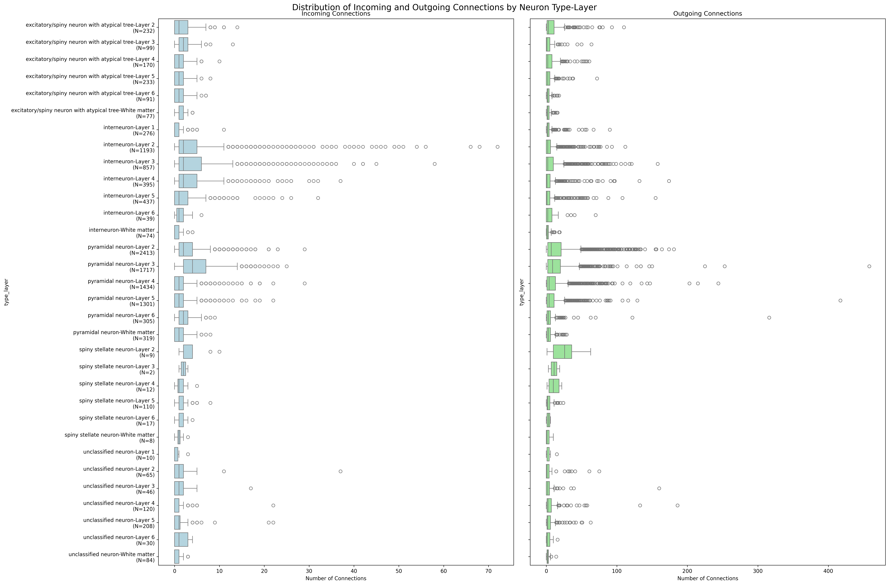
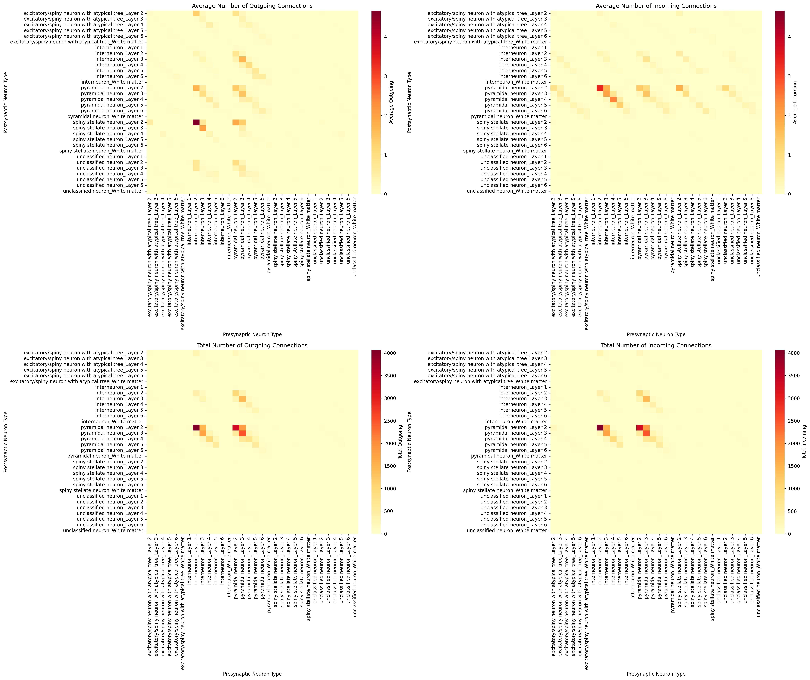

# Connectomics: H01 human cortex synapse analysis

Analysis of synaptic connectivity by cell type and cortical layer in the **H01** dataset, a petascale reconstruction of about 1 mm³ of human temporal cortex from the Lichtman lab (Shapson-Coe et al., *Science* 2024).

## What it does

- **Parse the raw synapse export.** `AvroParse.py` flattens the H01 synapse records (nested JSON) in chunks into one CSV. Each row holds the pre- and post-synaptic segment IDs, the E/I type, the structure type (axon, dendrite, soma) and the region or layer.
- **Build a neuron-level connectome.** `Lichtman basic analysis.py` defines `Neuron`, `NeuronGroup` and `Connectome` classes. For every segment that is a neuron (pyramidal, interneuron, spiny stellate, atypical excitatory, unclassified) it collects:
  - its input and output synapses, and which of those come from or go to other neurons;
  - input and output counts by partner cell type and layer.
- **Summarize connectivity by type.**
  - Distributions of in-degree and out-degree for each cell type and layer (`Plots/connection_distribution.png`).
  - Mean connectivity matrices between cell-type/layer groups (`Plots/weight_matrices.png`).
  - Basic dataset statistics.
- **Visualize the cell-to-cell matrix.** `connectome_analyzer.py` loads the soma-to-soma connection matrix (`connectome.csv`) with Polars and plots it on a log scale.




## Files

| File | Purpose |
|---|---|
| `AvroParse.py` | Convert the raw H01 synapse export to a flat CSV |
| `Lichtman basic analysis.py` | Main analysis: neurons, groups, degree distributions, type-by-type matrices |
| `connectome_analyzer.py` | Plot the soma-to-soma connection matrix |
| `plotting_function.py` | Shared plotting helpers (mean ± SD, box and swarm plots) |
| `synapses_toviah.csv` | Synapse table used by the analysis |
| `connectome.csv` | Soma-to-soma connection-count matrix |
| `neuron_data.pkl` | Cached per-neuron data |

## Running

```bash
pip install pandas numpy matplotlib seaborn tabulate polars tqdm
python "Lichtman basic analysis.py"
```

`AvroParse.py` expects the raw synapse export in a local folder. Set `data_folder` at the top of the script first.

## Note

Compared with the full connectome, neuron-to-neuron in- and out-degrees in this export came out orders of magnitude too small. We reported this to the Lichtman lab. Treat the absolute degree numbers with caution. Relative comparisons between cell types are more reliable.

## Related

- [minicolumn](https://github.com/tmoldwin/minicolumn): the same kind of analysis on a proofread MICrONS mouse V1 subnetwork.

## Author

[Toviah Moldwin](https://toviahmoldwin.com). Idan Segev lab, ELSC, Hebrew University of Jerusalem.
